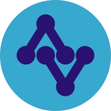
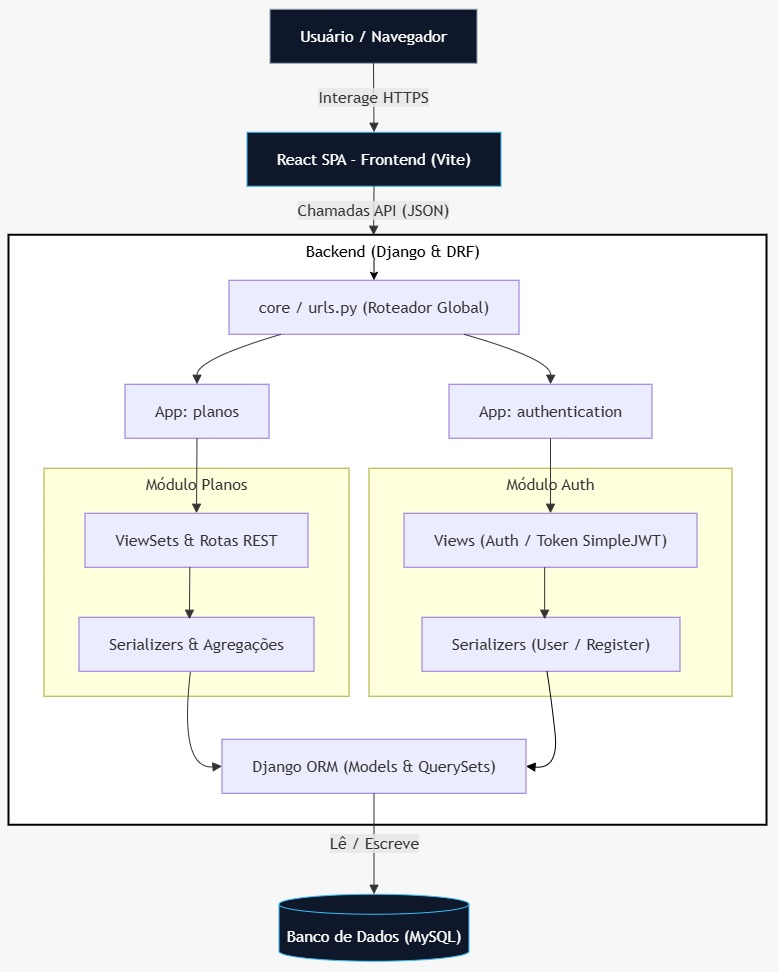

<p align="center">
  
</p>

<h1 align="center">
  Arkiv
</h1>

<p align="center">
  Plataforma de compartilhamento e curadoria pública de conteúdo didático para facilitar a descoberta de materiais de qualidade.</br>
  Projeto Final de Curso (PFC) de Engenharia de Software na UniEVANGÉLICA - Universidade Evangélica de Goiás (Anápolis, GO).
</p>

## Alunos

| Matrícula | Nome Completo |
|-----------|---------------|
| 2321753 | Braion D'Lucca Silva Carvalho |
| 2320857 | Gabriel Martins Leite |
| 2320877 | Gabryel Mariano da Silva |
| 2321036 | Lucas Santos da Conceição |

## Contextualização do Projeto

Arkiv visa ser uma plataforma de compartilhamento e curadoria pública de materiais didáticos para facilitar a descoberta de contéudo de qualidade. Seu principal objetivo é permitir que pessoas interessadas em aprender sobre determinados assuntos através da internet encontrem conteúdo relevante, e que realmente funcionam para seus objetivos, de forma rápida.

A solução incentiva materiais de qualidade ao permitir que usuários avaliem o conteúdo reunido por outros usuários, permitindo visibilidade baseada em valor e feedback que pode auxiliar na decisão de qual material estudar e diminuir tempo de busca e abandono de estudos.

## Arquitetura Geral

<p align="center">
  
</p>

A arquitetura do Arkiv segue o modelo monolítico modular. Todo o sistema foi implantado como uma única aplicação, mas internamente estruturado em módulos bem definidos, cada um com responsabilidades específicas. Essa abordagem foi escolhida para reduzir a complexidade operacional e de gerenciamento que outras arquiteturas exigiriam.

Os principais componentes do ecossistema são:

- **Frontend (Cliente):** Single Page Application (SPA) desenvolvida em React e gerenciada pelo Vite, responsável por toda a interface visual e interação.

- **Backend (Servidor):** Uma API RESTful desenvolvida em Python utilizando o framework Django em conjunto com o Django REST Framework (DRF). Esta aplicação é responsável pela implementação das regras de negócio, serialização dos dados, controle de autenticação segura via tokens JWT e comunicação com o banco de dados através do Django ORM.

- **Banco de Dados:** Um banco de dados relacional MySQL. O backend utiliza duas bases de dados (ou esquemas) separadas para isolar as responsabilidades.

## Instalação

1. Clone este repositório:

    ```
    git clone https://github.com/BraionDLucca/Arkiv
    ```

2. Instale as dependências:

    - **Frontend** (na pasta `frontend/`):
        ```
        npm install
        ```

    - Backend (`backend/`):
        ```bash
        cd backend
        python -m venv venv
        # No Windows:
        venv\Scripts\activate
        # No Linux/Mac:
        source venv/bin/activate

        pip install -r requirements.txt
        ```

## Execução (Ambiente de Desenvolvimento)

1. **Backend (Django):**

    Navegue até a pasta do backend, ative o ambiente virtual e execute as migrações do banco de dados antes de iniciar o servidor:

    ```bash
    cd backend

    # Executar as migrações das tabelas do Django
    python manage.py migrate

    # Iniciar o servidor de desenvolvimento
    python manage.py runserver
    ```
    O backend estará rodando em `http://127.0.0.1:8000/`.

2. **Frontend (React + Vite):**

    Em outro terminal, navegue até a pasta do frontend e inicie a aplicação:

    ```bash
    cd frontend
    npm run dev
    ```
    O frontend estará acessível no endereço indicado pelo Vite (geralmente `http://localhost:5173/`).
