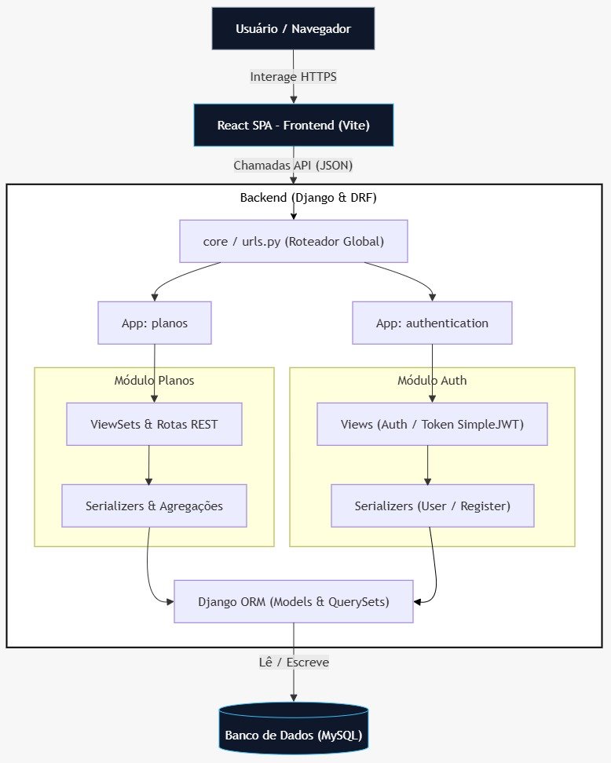

<p align="center">
  
</p>

<h1 align="center">
  Arkiv
</h1>

<p align="center">
  Plataforma de compartilhamento e curadoria pública de conteúdo didático para facilitar a descoberta de materiais de qualidade.</br>
  Projeto Final de Curso (PFC) de Engenharia de Software na UniEVANGÉLICA - Universidade Evangélica de Goiás (Anápolis, GO).
</p>

## Alunos

| Matrícula | Nome Completo |
|-----------|---------------|
| 2321753 | Braion D'Lucca Silva Carvalho |
| 2320857 | Gabriel Martins Leite |
| 2320877 | Gabryel Mariano da Silva |
| 2321036 | Lucas Santos da Conceição |

## Contextualização do Projeto

Arkiv visa ser uma plataforma de compartilhamento e curadoria pública de materiais didáticos para facilitar a descoberta de contéudo de qualidade. Seu principal objetivo é permitir que pessoas interessadas em aprender sobre determinados assuntos através da internet encontrem conteúdo relevante, e que realmente funcionam para seus objetivos, de forma rápida.

A solução incentiva materiais de qualidade ao permitir que usuários avaliem o conteúdo reunido por outros usuários, permitindo visibilidade baseada em valor e feedback que pode auxiliar na decisão de qual material estudar e diminuir tempo de busca e abandono de estudos.

## Arquitetura Geral

<p align="center">
  
</p>

A arquitetura do Arkiv segue o modelo monolítico modular. Todo o sistema foi implantado como uma única aplicação, mas internamente estruturado em módulos bem definidos, cada um com responsabilidades específicas. Essa abordagem foi escolhida para reduzir a complexidade operacional e de gerenciamento que outras arquiteturas exigiriam.

Os principais componentes do ecossistema são:

- **Frontend (Cliente):** Single Page Application (SPA) desenvolvida em React e gerenciada pelo Vite, responsável por toda a interface visual e interação.

- **Backend (Servidor):** Uma API RESTful desenvolvida em Python utilizando o framework Django em conjunto com o Django REST Framework (DRF). Esta aplicação é responsável pela implementação das regras de negócio, serialização dos dados, controle de autenticação segura via tokens JWT e comunicação com o banco de dados através do Django ORM.

- **Banco de Dados:** Um banco de dados relacional MySQL. O backend utiliza duas bases de dados (ou esquemas) separadas para isolar as responsabilidades.

## Instalação

1. Clone este repositório:

    ```
    git clone https://github.com/BraionDLucca/Arkiv
    ```

2. Instale as dependências:

    - **Frontend** (na pasta `frontend/`):
        ```
        npm install
        ```

    - **Backend** (na pasta `backend/`):

        ```
        pip install -r requirements.txt
        ```

## Execução (Ambiente de Desenvolvimento)

Para executar o projeto, é necessário ter um banco de dados MySQL configurado com a estrutura e os dados necessários.

1. Na raiz do projeto, acesse a pasta `seeders/`, que contém duas subpastas:

   - `schema/`: arquivos `.sql` responsáveis pela criação dos schemas `planos` e `USER` e suas respectivas tabelas.
   - `seed/`: arquivos `.sql` responsáveis pela inserção de dados de teste no banco de dados.

2. Execute os arquivos da pasta `seeders/schema/` para criar a estrutura do banco de dados.

3. Execute o arquivo `planos_seed.sql`, localizado em `seeders/seed/`, para popular o banco com dados de teste. Caso prefira utilizar seus próprios dados, esta etapa pode ser ignorada.

4. Configure as variáveis de ambiente a partir dos arquivos `.env.example`, preenchendo os valores de acordo com o seu ambiente:

   - `frontend/.env.example`:
     - `VITE_API_URL`: URL base do backend (API). Por padrão, utilize `http://127.0.0.1:5000`.
     - `VITE_FRONTEND_URL`: URL em que o frontend será executado. Por padrão, utilize `http://localhost:5173`.

   - `backend/config.env.example`:
     - `MYSQL_HOST`: endereço do servidor MySQL. Utilize `localhost` se estiver executando localmente.
     - `MYSQL_USER`: usuário de acesso ao MySQL (ex.: `root`).
     - `MYSQL_PASSWORD`: senha do usuário informado.
     - `MYSQL_DB`: nome do schema utilizado pelo backend. Neste arquivo, utilize `planos`.

   - `backend/config_user.env.example`:
     - `MYSQL_HOST`: endereço do servidor MySQL.
     - `MYSQL_USER`: usuário de acesso ao MySQL.
     - `MYSQL_PASSWORD`: senha do usuário informado.
     - `MYSQL_DB`: nome do schema utilizado pelo backend. Neste arquivo, utilize `USER`.
     - `SECRET_KEY`: chave secreta utilizada para operações de segurança e assinatura de tokens. Defina uma chave aleatória e segura, mantendo-a privada.

   Caso tenha alterado os nomes dos schemas, atualize também os valores de `MYSQL_DB` nos respectivos arquivos.

5. Renomeie os arquivos terminados em `.env.example`, removendo o sufixo `.example`.

6. Inicie o projeto em ambiente de desenvolvimento:

   - **Frontend** (na pasta `frontend/`):

     ```bash
     npm run dev
     ```

   - **Backend** (na pasta `backend/`):

     ```bash
     python app.py
     ```